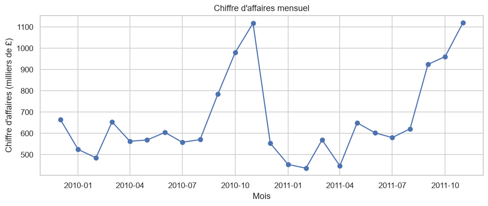
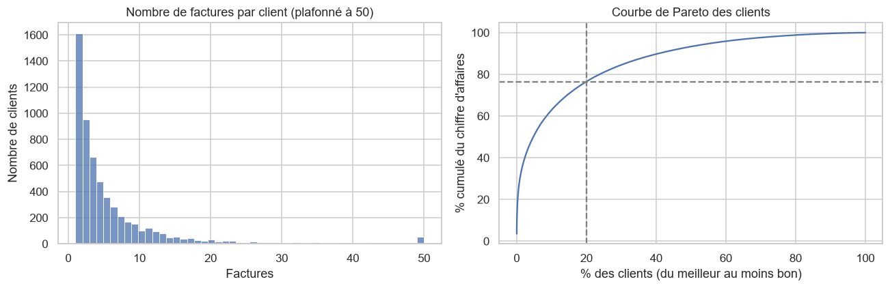

# Analyse client e-commerce — Data Mining & Machine Learning

  

Projet complet de data mining sur ~1 million de transactions réelles d'un commerce en ligne :
**segmentation des clients**, **règles d'association** et **prédiction du churn**.

## Problématique

| # | Question métier | Technique |
|---|---|---|
| Q1 | Quels sont les différents types de clients ? | Segmentation RFM + clustering (K-means, DBSCAN, hiérarchique) |
| Q2 | Quels produits sont achetés ensemble ? | Règles d'association (Apriori, FP-Growth) |
| Q3 | Quels clients risquent de ne plus acheter ? | Classification supervisée + interprétabilité (SHAP) |

## Données

[Online Retail II](https://archive.ics.uci.edu/dataset/502/online+retail+ii) (UCI Machine Learning Repository) :
transactions d'un e-commerçant britannique entre décembre 2009 et décembre 2011.

Colonnes : `Invoice`, `StockCode`, `Description`, `Quantity`, `InvoiceDate`, `Price`, `Customer ID`, `Country`.

Les données ne sont pas versionnées. Pour les télécharger :

```bash
python -m src.download_data
```

## Avancement

- [x] Module A — Nettoyage et exploration (`notebooks/01_eda.ipynb`)
- [ ] Module B — Segmentation RFM et clustering
- [ ] Module C — Règles d'association
- [ ] Module D — Prédiction du churn
- [ ] Module E — Synthèse et recommandations

## Résultats clés

### Module A — Nettoyage et exploration

| Indicateur | Valeur |
|---|---|
| Lignes conservées | 767 351 / 1 067 371 (71,9 %) |
| Factures · Clients · Produits · Pays | 36 267 · 5 838 · 4 612 · 41 |
| Chiffre d'affaires | 16,3 M£ (déc. 2009 → déc. 2011) |
| Part du CA des 20 % meilleurs clients | 76,5 % |
| Clients n'ayant acheté qu'une fois | 27,6 % |

- Une annulation ne supprime pas la commande d'origine : sans appariement des annulations, des commandes de
  80 995 articles annulées le jour même faussaient l'analyse (ligne max. 168 470 £ → 8 925 £ après correction).
- Forte saisonnalité de fin d'année (commerce de cadeaux) et quasiment aucune vente le samedi.




_Les modules suivants seront ajoutés au fil du projet._

## Installation

```bash
git clone https://github.com/salahfellah/customer-analytics-data-mining.git
cd customer-analytics-data-mining
python -m venv .venv
# Windows : .venv\Scripts\activate   |   Linux/macOS : source .venv/bin/activate
pip install -r requirements.txt
python -m src.download_data
pytest
jupyter notebook notebooks/
```

## Structure

```
├── data/              raw/ et processed/ (non versionnés)
├── notebooks/         un notebook par module
├── src/               code réutilisable (téléchargement, nettoyage, features...)
├── tests/             tests unitaires (pytest)
├── models/            modèles entraînés
└── reports/figures/   graphiques exportés
```

## Ce que j'ai appris

_À compléter à la fin du projet._

## Auteur

Ghofrane El Hadj Salah Fellah — Ingénieur d'État en informatique, génie logiciel (Université Constantine 2)

- GitHub : [salahfellah](https://github.com/salahfellah)
- LinkedIn : Fellah Salah
- Email : [eng.fellahsalah@gmail.com](mailto:eng.fellahsalah@gmail.com)
